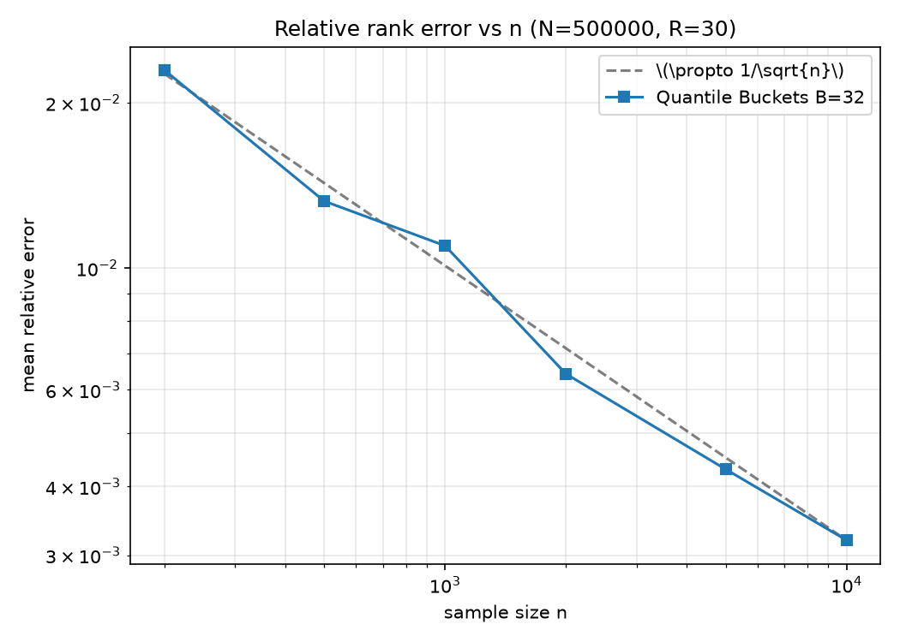

# ProbCut: Probabilistic Quantile Index

基于抽样 ECDF 的轻量级近似排名索引。用极低的内存开销（O(n)），预测海量数据（O(N)）的全局排名。

## 💡 核心思想
在超大规模数据场景下，传统全量排序面临算力瓶颈。本项目验证了：**利用少量随机抽样构建经验累积分布函数（ECDF），可以在相对排名误差严格收敛于 \(O(1/\sqrt{n})\) 的前提下，替代全量数据计算。**
误差仅与抽样量 \(n\) 相关，与总数据量 \(N\) 无关（基于 DKW 不等式）。

## 📊 核心实验结果
- **极简的 1/√n 缩放**：在 \(N=500,000\) 的数据集上，改变抽样量 \(n\)，相对排名误差严格贴合理论斜率 `-0.5`。
- **纯 ECDF 与线性插值（分位桶）的对比**：分位桶（Quantile Buckets）在数学上等价于全局相邻点线性插值，彻底消除了阶梯函数的量化误差。

 
*(注：运行代码后会生成这张图)*

## 🚀 快速开始
1. 安装依赖: `pip install numpy matplotlib`
2. 运行实验: `python prob_cut.py`

## 📌 结论与展望
1. 纯全局插值在样本量达到 2000 时，已是极其鲁棒的物理极限。
2. 未来方向：将该结构落盘，结合 B 树做外存 I/O 优化，用于分布式数据库的概率路由。
